  

  
  
  
  
  
  
  

# 🛡️ Awesome Occupational Safety &amp; EHS Ecosystem

> 🌟 **A curated directory of leading SaaS platforms, AI computer vision PPE detectors, incident management systems, OSHA datasets, and open-source HSE tools.**
> 
> *Focusing on Workplace Safety, Incident Logging, Mobile Inspections, Safety Audits, Risk Assessments, Chemical &amp; SDS Safety, ISO 45001 Compliance, and Frontline Worker Protection.*

---

## 📌 Table of Contents
- [🏢 SaaS / Hosted EHS Platforms](#-saashosted-platforms)
- [⚡ Open-Source GitHub Projects](#-open-source-github-projects)
- [🏗️ Frameworks for Custom EHS Systems](#️-frameworks-for-building-custom-safety-systems)
- [🤝 How to Contribute](#-how-to-contribute)
- [📈 Star History](#-star-history)
- [⚠️ Disclaimer](#️-disclaimer)

---

## 🏢 SaaS/Hosted Platforms

> 📊 **Market Size &amp; Industry Structure**: The global Occupational Health &amp; Safety (EHS) Software market is currently estimated at **~$2.1B – $2.5B** and is projected to expand to **$4.5B – $6.0B by the early 2030s (~10–12% CAGR)**. The sector is **moderately fragmented**—comprising hundreds of niche point solutions and regional software vendors, but undergoing active consolidation through private equity and strategic M&A where the top 10 enterprise leaders collectively command ~50% of global software revenue without a single winner-take-all monopoly.

| Product / Platform | Company Size (Valuation / Revenue) | Description &amp; Core Focus | Starting Pricing | Free Tier / Trial Limits |
| :--- | :--- | :--- | :--- | :--- |
| **[SafetyCulture (Mitti / iAuditor)](https://safetyculture.com/)** | **~$2.5B Valuation**  *(~$197M ARR / FY2025)* | 📱 Mobile-first frontline operations platform focused on inspections, audits, checklists, and incident reporting with extensive template libraries and offline support. | Starts at **$24/user/month** (billed annually) or $29/user/month (billed monthly) | **Free Forever Plan**: Up to 10 active users, 5 active inspection templates, 300 AI credits/month, and unlimited inspections (includes 30-day Premium trial) |
| **[Cority](https://www.cority.com/)** | **~$1.5B–$2.0B Valuation**  *(~$150M–$200M ARR, Thoma Bravo)* | 🏥 Enterprise EHSQ platform with deep occupational health, industrial hygiene, environmental management, safety, and ESG capabilities for large global enterprises. | Starts at **~$40–$50/user/month** (enterprise deployments start at ~$40,000–$80,000/year base depending on modules) | **Guided Enterprise Pilot**: Custom proof-of-concept / evaluation sandbox provided upon direct enterprise qualification |
| **[EcoOnline](https://www.ecoonline.com/)** | **~$1.3B (£1.0B) Valuation**  *(~$100M–$120M ARR, Apax Partners)* | 🧪 European-oriented EHS &amp; chemical safety management platform covering SDS compliance, lone-worker safety, incident reporting, and sustainability. | Starts at **~£3,000/year (~$3,800/year)** per core module (Safety/Chemical Manager) | **Guided POC / Trial**: Customized proof-of-concept environment provided during the sales evaluation process |
| **[VelocityEHS](https://www.velocityehs.com/)** | **~$1.0B+ Valuation**  *(~$100M–$150M ARR, CVC Capital)* | 🔬 Comprehensive EHS suite known for chemical management, SDS authoring, AI ergonomics (Humantech), incident logs, and operational risk programs. | Starts at **~$100–$200/month** for single-user entry-level chemical/incident modules (~$500–$1,000/mo for 10 users) | **Free Trial (SDS module)**: Includes up to 5 Safety Data Sheet (SDS) downloads; 30-day guided pilot available upon sales request |
| **[Intelex](https://www.intelex.com/)** | **$570M Acquisition Valuation**  *(~$90M–$120M ARR, Fortive)* | 📋 Highly configurable enterprise EHS &amp; quality management system supporting incident reporting, audits, risk matrices, and operational excellence workflows. | Starts at **$44–$49/user/month** (Safety Essentials plan, billed annually with a 25-user minimum ~$13,200/year) | **Custom Free Trial**: Available upon qualification request (no credit card required) for evaluation environments |
| **[KPA (KPA Flex)](https://www.kpa.io/)** | **~$80M–$100M ARR**  *(Providence Equity Partners)* | 🦺 Safety and compliance management platform tailored for industrial, manufacturing, and contractor workflows, covering training, safety audits, and OSHA logs. | Starts at **~$24–$29/user/month** (or ~$3,000–$5,000/year for entry-level workforce bundles) | **Demo / Sandbox Trial**: Available upon sales request for pilot testing safety inspection workflows |
| **[Evotix](https://www.evotix.com/)** | **~$30M–$50M ARR**  *(SAI360 / Baring PE Asia)* | 🔍 Configurable mid-market to global EHS software supporting risk assessments, incident management, audits, and frontline safety engagement. | Starts at **~£9,995/year (~$12,500/year)** for foundational standalone modules | **Guided Sandbox Trial**: Access provided following initial scoping and requirements consultation |
| **[SiteDocs](https://www.sitedocs.com/)** | **~$20M–$35M ARR**  *(Private / Bootstrapped &amp; Scaled)* | 🏗️ Paperless safety management system purpose-built for construction contractors and trades, replacing physical forms with real-time mobile safety workflows. | Starts at **~$1,500–$2,500/year** for small contractor teams | **7-Day Guided Trial**: Available upon sales consultation with sample safety form templates and admin access |
| **[EHS Insight](https://www.ehsinsight.com/)** | **~$10M–$20M ARR**  *(StarGate Capital)* | 📈 Mid-market cloud EHS solution emphasizing fast deployment for mobile safety inspections, incident investigations, audit trails, and compliance tracking. | Starts at **~$9/user/month** (or ~$4,600–$5,000/year for standard SMB packages) | **14-Day Free Trial**: Full access to core incident management and inspection modules |
| **[Safesite](https://www.safesitehq.com/)** | **~$5M–$15M ARR**  *(~$50M–$100M Valuation, Insight Partners)* | 📱 Mobile-first safety application focused on daily safety observations, hazard logs, toolbox talks, and OSHA 300 logs for construction sites. | Starts at **$16/member/month** (billed annually) or $20/member/month (billed monthly) | **Free Forever Plan**: Unlimited members and mobile app access, restricted to 30 days of historical reporting data (includes 30-day Premium trial) |

---

## ⚡ Open-Source GitHub Projects

*Open-source tools, computer vision models, safety calculators, and research frameworks for occupational health &amp; safety engineering. Repositories are sorted by GitHub Star Count.*

| Repository | Stars | Category | Description |
| :--- | :---: | :--- | :--- |
| **[Ansarimajid/Construction-PPE-Detection](https://github.com/Ansarimajid/Construction-PPE-Detection)** |  | 👁️ AI / Computer Vision | Real-time computer vision system using YOLOv8, FastAPI, Docker, and alert dashboards to enforce PPE compliance on construction sites. |
| **[Morteza-Asadi-Shalmaiy/PPE-Detection-YOLOv8](https://github.com/Morteza-Asadi-Shalmaiy/PPE-Detection-YOLOv8)** |  | 👁️ AI / Deep Learning | Fine-tuned YOLOv8 deep learning model for detecting hard hats, high-visibility vests, goggles, and safety gear in video streams. |
| **[aws-samples/amazon-rekognition-custom-ppe-detection](https://github.com/aws-samples/amazon-rekognition-custom-ppe-detection-with-custom-labels)** |  | ☁️ Cloud AI Vision | Serverless PPE detection architecture on AWS using Rekognition Custom Labels to identify workplace safety gear compliance. |
| **[VinhTechiee/FOURUT_Worker_Health_Safety_Monitoring](https://github.com/VinhTechiee/FOURUT_Worker_Health_Safety_Monitoring)** |  | 📳 IoT &amp; Wearables | Real-time construction worker health &amp; safety monitoring platform integrating IoT sensors for fall detection, vital signs, and fatigue tracking. |
| **[safetyhub/OSHA_Acc](https://github.com/safetyhub/OSHA_Acc)** |  | 📊 OSHA Data &amp; NLP | Historical US OSHA workplace accident and injury dataset equipped with NLP text classification models for occupational risk categorization. |
| **[SmartQHSE/awesome-hse](https://github.com/SmartQHSE/awesome-hse)** |  | 📚 Curated Resources | Comprehensive directory of Health, Safety &amp; Environment (HSE) software, standards, regulatory frameworks, datasets, and open tools. |
| **[SmartQHSE/hse-calculators](https://github.com/SmartQHSE/hse-calculators)** |  | 🧮 HSE Math &amp; Metrics | Open-source TypeScript/Python calculation suite for safety metrics: TRIR, LTIR, DART, EMR, WBGT Heat Stress, Noise Dosimetry, and Ergonomics (REBA/RULA/NIOSH). |
| **[SafetyMP/Autonomous-EHS-Management](https://github.com/SafetyMP/Autonomous-EHS-Management)** |  | 💻 Web Platform | Self-hostable, open-source EHS console for tracking incidents, near-misses, corrective and preventive actions (CAPA), and safety audit logs. |
| **[braedonsaunders/beaconhs](https://github.com/braedonsaunders/beaconhs)** |  | 🏗️ Industrial EHS | Open-source HSE web platform for industrial construction handling incident reporting, equipment tracking, safety permits, and custom form builders. |
| **[TheOregonian/osha](https://github.com/TheOregonian/osha)** |  | 🐍 Python ETL / Data | Open-source data scraper and parser for downloading and standardizing federal OSHA workplace inspection and safety violation records. |
| **[BlakeWilliams/OSHA](https://github.com/BlakeWilliams/OSHA)** |  | ⚙️ Automation Scripts | Python automation utilities and reporting tools for occupational health and safety data analysis. |
| **[api-evangelist/occupational-safety-and-health-administration](https://github.com/api-evangelist/occupational-safety-and-health-administration)** |  | 🔌 API Specifications | OpenAPI specifications and API definitions for querying OSHA safety inspection and violation databases. |

---

### 🏗️ Frameworks for Building Custom Safety Systems

Organizations with strict data-residency or custom workflow requirements can combine modular open-source building blocks:
- **🗂️ Core EHS Engine**: Start with an open EHS framework such as **BeaconHS** or **Autonomous-EHS-Management** for incident intake, investigations, and CAPA.
- **📱 Dynamic Inspections**: Integrate open form builders and mobile inspection frontends (e.g. Form.io, ODK Collect) for field checklists.
- **🧮 Standardized Metric Engines**: Utilize **SmartQHSE/hse-calculators** for automated calculations of OSHA TRIR, DART, LTIR, WBGT heat index, and NIOSH lifting limits.
- **👁️ Computer Vision &amp; PPE Guardrails**: Deploy edge YOLOv8 models for real-time safety harness, hard hat, and high-visibility vest monitoring.
- **🤖 LLM Incident Narratives**: Feed unstructured near-miss and incident reports into local LLM pipelines for automatic root-cause analysis (5 Whys, Bowtie analysis) and regulatory hazard classification.
- **📊 Unified Dashboards**: Pipe safety KPIs, leading indicators, and audit scores into Grafana or Apache Superset dashboards.

---

## 🤝 How to Contribute

1. 🍴 Fork the repository.
2. 📝 Add or update entries in [`README.md`](file:///C:/Users/ishan/Documents/Projects/Awesome-Occupational-Safety/README.md) following the existing structured format.
3. 🔗 Ensure all SaaS entries include verified starting prices and explicit free tier/trial limits.
4. ⭐ Ensure all open-source repositories include a valid `shields.io` star badge linking to their stargazers page.
5. 🚀 Submit a Pull Request with a brief explanation of your additions.

---

## 📈 Star History

---

## ⚠️ Disclaimer

- This is a **community-curated list** provided for informational purposes—not an endorsement.
- Occupational safety systems inform life-critical decisions and regulatory compliance (OSHA, ISO 45001, ANSI, EU-OSHA). Always consult certified EHS professionals, legal advisors, and operational stakeholders prior to production deployment.

---

  <b>Made with 💚 for EHS managers, safety engineers, and organizations dedicated to protecting workers everywhere.</b>

